# Earned Value Management (EVM) Calculation Plugin

[](http://www.redmine.org/plugins/redmine_issue_evm)

This plugin calculates the EVM (Earned Value Management) values of your projects from the start date, due date, estimated time and spent time of the issues, and shows them with charts. EVM helps you to track the progress and status of a project and to forecast its future performance.

# Version and compatibility
* Plugin version: 7.0.0
* Compatible with **Redmine 7.0 and above only**.

This plugin uses the features of Redmine 7 (for example, the SVG icons). It does not work with earlier versions of Redmine.

# Main features
## Calculate EVM with charts
* All projects (including descendant projects) with ES
* Each version
* Each assignee (shows the estimated hours of each day on the chart)
* Each parent issue
* Some trackers
* Calculating EV based on the daily done ratio
* Daily EAC
* List of the issues excluded from the calculation
* EVM summary on the project overview page

## Project metrics
* Duration
* Status
* Days until the due date
* Number of the issues used for the calculation
* Variance from the baseline and the list of the issues
* Number of issues of each version, assignee and tracker
* Chart of EVM (PV, EV, AC). The forecast is not shown when the project is finished.

## Baselines
* Record the PV of a project at a point in time
* View the details and the history of the baselines

## Project reports based on EVM
* Record the project overview together with the EVM values
* List, show and edit the past reports

## Common setting
* Basis hours of a day, excluding holidays and weekends (and the region of the holidays)
* Calculation method of ETC
* Forecast chart, performance chart, threshold values and the list of incomplete issues

# Installation
(1) Get the plugin source

**Zip file**

* Download the zip file.
* Create a folder named `redmine_issue_evm` under `[redmine_root]/plugins/`.
* Extract the zip file into that folder.

**git clone**

```
git clone https://github.com/momibun926/redmine_issue_evm [redmine_root]/plugins/redmine_issue_evm
```

(2) Install the gems (from `[redmine_root]`)

```
bundle install
```

(3) Run the migration

```
bundle exec rake redmine:plugins:migrate NAME=redmine_issue_evm RAILS_ENV=production
```

(4) Precompile the assets (the icons and the stylesheet of the plugin)

```
bin/rails assets:precompile RAILS_ENV=production
```

(5) Restart Redmine.

If the icons or the layout of the plugin are not shown correctly, clear the cache of your browser (Ctrl+F5).
Run (4) and restart Redmine again whenever you update the plugin and its stylesheets, scripts or images were changed.

# Uninstallation
```
bundle exec rake redmine:plugins:migrate NAME=redmine_issue_evm VERSION=0 RAILS_ENV=production
```

Then remove the `redmine_issue_evm` folder from `[redmine_root]/plugins/` and restart Redmine.

# Getting started
(1) Set the permissions in Administration > Roles and permissions. The permissions of this plugin are listed in the section "EVM".

(2) Enable the module "EVM" in Settings > Modules of the project.

(3) Click the "EVM" tab of the project. The first time, the common setting page is shown. Save the setting to start using the plugin.

## Permissions
| Permission | What you can do |
| --- | --- |
| View EVM | Show the EVM tab and its pages (project, versions, assignees, parent issues, trackers, excluded issues and the baseline difference). Only the members of the project can use it. |
| View Baseline | Show the list, the history and the details of the baselines. |
| Edit Baseline | Create, edit and delete the baselines (and show them). |
| Edit Common Setting | Create and edit the common setting of the project. |
| View Project report | List, show, create, edit and delete the project reports. |

## Dates and time zones
* The basis date (status date) is the date of your browser when you open the EVM page for the first time.
* Dates in other pages (for example, the project overview and the activity) follow the time zone of your account. If it is not set, the time zone of the server is used. In that case, the date can be one day behind in the morning, for example in Japan when the server runs in UTC. Please set the time zone in My account.

# How to calculate EVM
The following items of an issue are used.

* start date
* due date (If empty, the effective date of the version)
* estimated time (If you set it to 0, you will not get PV and CV)
* spent time

If you input these into your project, the plugin calculates both the EVM of each issue and the EVM of the whole project. The PV and EV are calculated for each issue, regardless of the parent-child relationship of the issues.

* PV: The estimated time is divided by the number of days (from the start date to the due date, or the effective date of the version) to get the daily workload. The PV is the accumulation of it.
* EV: After an issue is closed, you get the EV on that day. When the done ratio is set, the EV is the estimated time multiplied by the done ratio, on the day when the done ratio is set.
* AC: Total work hours of the issues used for the PV.

**Example**

(1) Create an issue with:

* start date: 2015/08/01
* due date: 2015/08/03
* estimated time: 24 hours

At that time, only PV is calculated. As you have not closed the issue yet, EV equals 0.
PV: dividing the estimated time (24 hours) by 3 days (from the start date to the due date) gives 8 hours per day.

| EVM | 8/1 | 8/2 | 8/3 |
| --- | --- | --- | --- |
| PV  | 8   | 16  | 24  |
| EV  | 0   | 0   | 0   |
| AC  | 0   | 0   | 0   |

(2) Input your spent time.

8/1: 10.0 hours, 8/2: 6.0 hours, 8/3: 8.0 hours

| EVM | 8/1 | 8/2 | 8/3 |
| --- | --- | --- | --- |
| PV  | 8   | 16  | 24  |
| EV  | 0   | 0   | 0   |
| AC  | 10  | 16  | 24  |

(3) After finishing the issue, close it on 8/3. EV is calculated on 8/3.

| EVM | 8/1 | 8/2 | 8/3 |
| --- | --- | --- | --- |
| PV  | 8   | 16  | 24  |
| EV  | 0   | 0   | 24  |
| AC  | 10  | 16  | 24  |

Based on these data, the EVM values and the charts are created.

## Baseline
A baseline records the PV of the project at a point in time. After you set a baseline, you can see in the chart how far the project diverges from it, for example whether new issues were added or the schedule was changed. In other words, you can see whether your estimated daily workload is over or not.
When a baseline is set, the EVM values are calculated based on the baseline. In the view options you can choose to calculate without the baseline. Then all the issues, including the ones added or changed after the baseline was created, are used for the calculation.
You can also look at the baselines created in the past.

## View options
* Change the basis date of the calculation
* Use the baseline or not
* Show the explanation of the EVM values

## About working days
1. Weekends and holidays can be excluded from the calculation of PV (set it in the common setting page).
2. If the period of an issue consists only of weekends and holidays, all of the days are working days.
3. Holidays are provided by the holidays gem. Set the region in the common setting page (the "Common setting" link in the contextual menu).

Example)

In Japan, May 3, May 4 and May 5 are holidays.

* The period includes weekends and holidays

|Start date          |Due date            |Estimated time |Working days|PV per day|
|--------------------|--------------------|---------------|------------|----------|
|May 1, 2017 (Monday)|May 8, 2017 (Monday)|12 hours       |3 days      |4 hours   |

* The period includes weekends and holidays (the due date is a weekend)

|Start date          |Due date            |Estimated time |Working days|PV per day|
|--------------------|--------------------|---------------|------------|----------|
|May 1, 2017 (Monday)|May 7, 2017 (Sunday)|10 hours       |2 days      |5 hours   |

* The period consists only of weekends and holidays

|Start date          |Due date            |Estimated time |Working days|PV per day|
|--------------------|--------------------|---------------|------------|----------|
|May 3, 2017 (Wed)   |May 7, 2017 (Sunday)|20 hours       |5 days      |4 hours   |

# Charts
The charts are drawn with Chart.js. Chart.bundle.min.js (Chart.js v2.8.0) and chartjs-plugin-annotation (v0.5.7) are included in this plugin.

**Main chart**
Displays the cumulative PV, EV and AC values of the calculated issues in a time series. If a baseline has been set, the baseline is also displayed.

**Performance chart**
Calculates and displays SPI, CPI and CR only on the days when PV, EV and AC are calculated. If the project members frequently close issues and enter work hours, the accuracy of measuring and predicting the performance of the whole project improves.

**Chart by version**
Very useful if your project uses versions. You can select any version of the project to view its chart.

**Chart by assignee**
Very useful if you have many members in your project. You can see the performance of each member, which is not possible if you only look at the whole project.

**Chart by parent issue**
For those who manage tasks with a hierarchical structure of issues.

**Chart by tracker**
For those who manage trackers in a subdivided manner and do not want to include some trackers in the EVM calculation. You can select only the trackers you need and display the chart.

# Screenshots
**Overview - EVM**
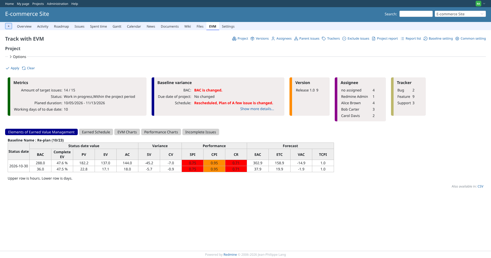

**Overview - ES**
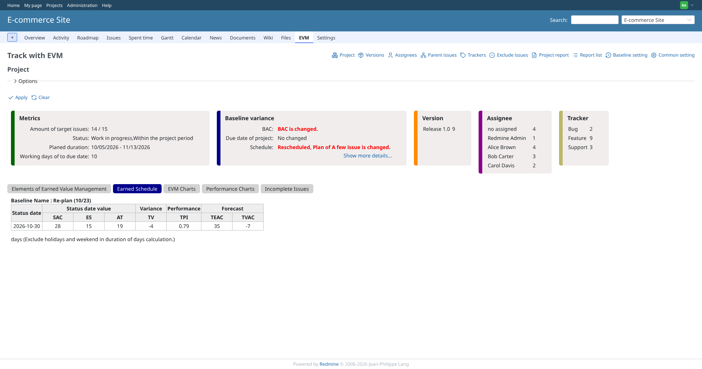

**Overview - EVM chart**
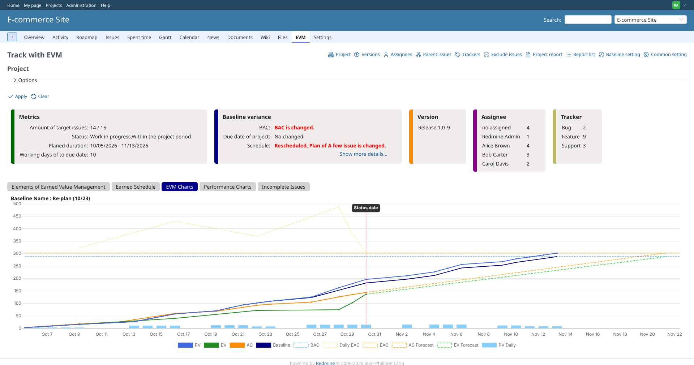

**Overview - Performance chart**
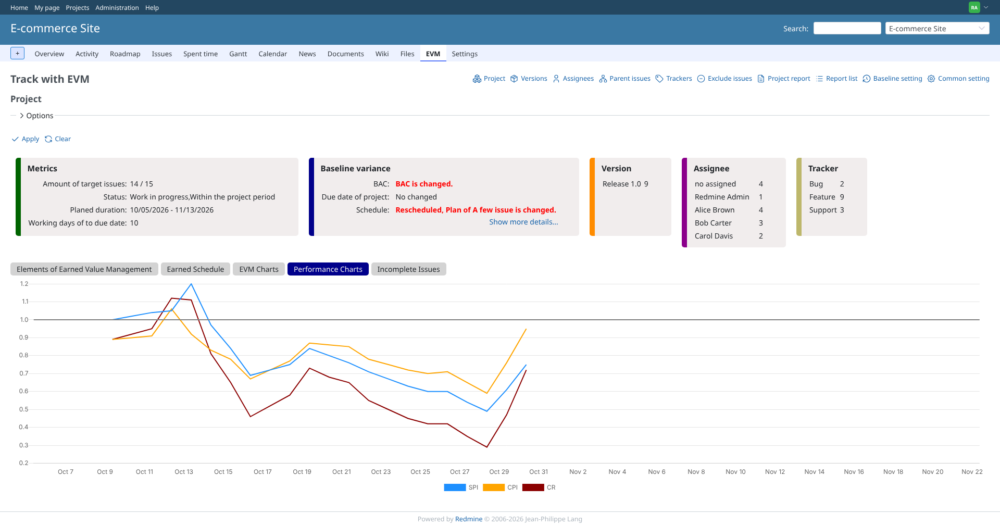

**Overview - Incomplete issues**
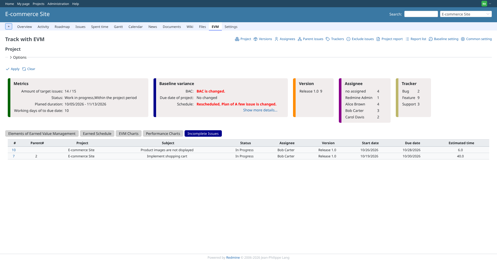

**Assignees**
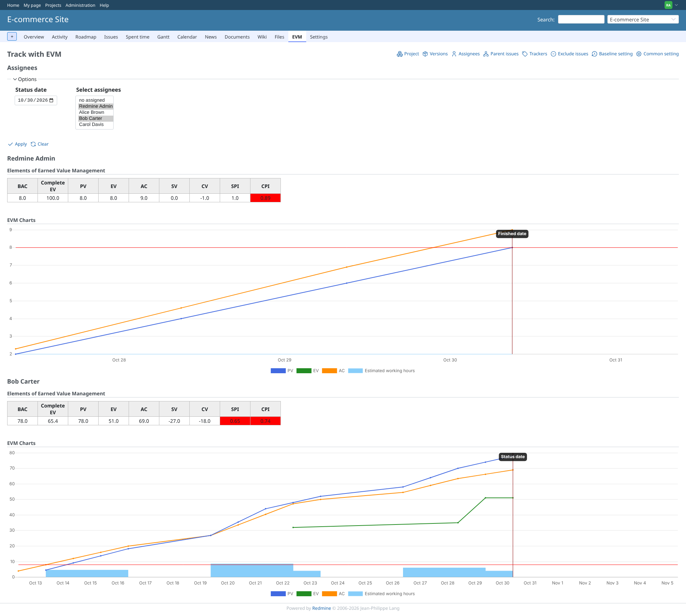

**Parent issues**
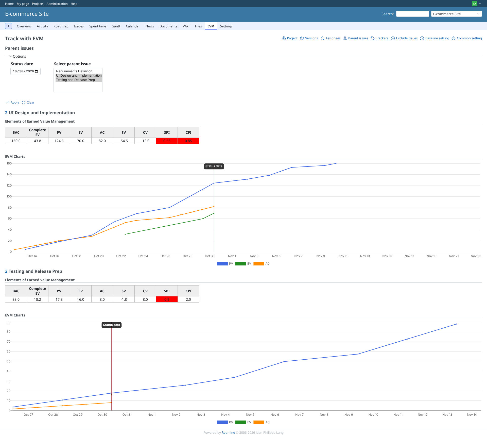

**Trackers**
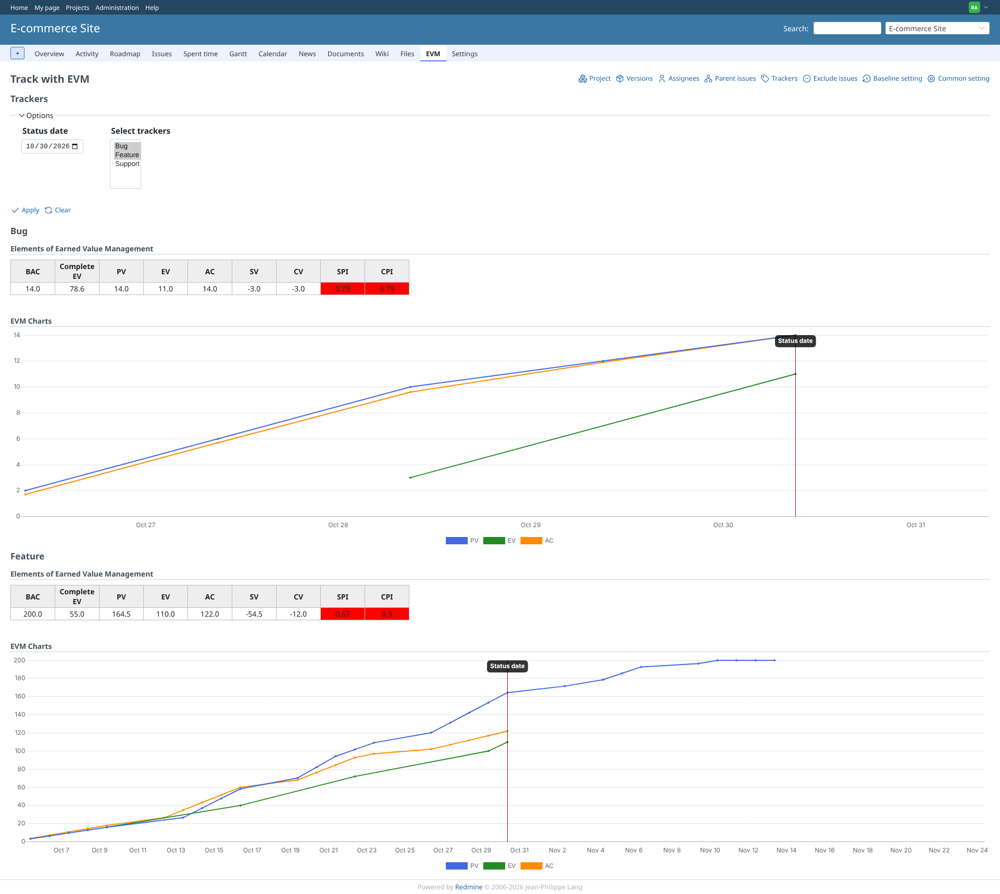

**Create baseline**
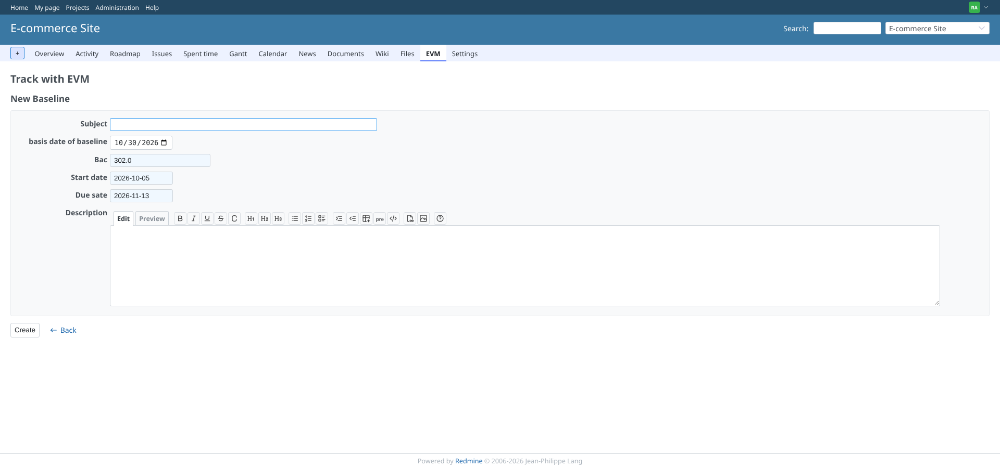

**Baseline history**
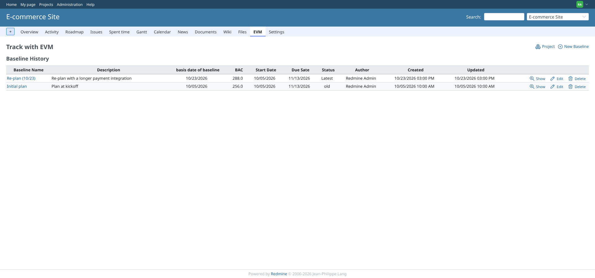

**Common setting**
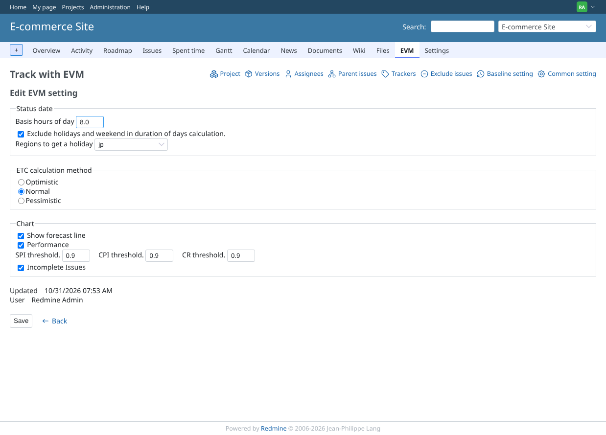

# Development
## Environment
The plugin is developed and tested with:

* Redmine 7.0.2
* Ruby 4.0.0
* Rails 8.1.3
* PostgreSQL

## Tests
The tests are in `test/`. Run them from `[redmine_root]` (the test database of Redmine must be prepared):

```
bundle exec rake redmine:plugins:test NAME=redmine_issue_evm RAILS_ENV=test
```

## Coding style
The style is checked with RuboCop (RuboCop 1.72 or later, rubocop-rails and rubocop-performance). Run it in the plugin folder. The settings are in `.rubocop.yml`.

```
rubocop
```

## Contributing
1. Fork it
2. Create your feature branch (git checkout -b my-new-feature)
3. Commit your changes (git commit -am 'Add some feature')
4. Push to the branch (git push origin my-new-feature)
5. Create new Pull Request

# Languages and translators
English, Japanese, Chinese, Czech, Spanish and Portuguese are supported.
I appreciate your cooperation, Wen Wen, Shen.
