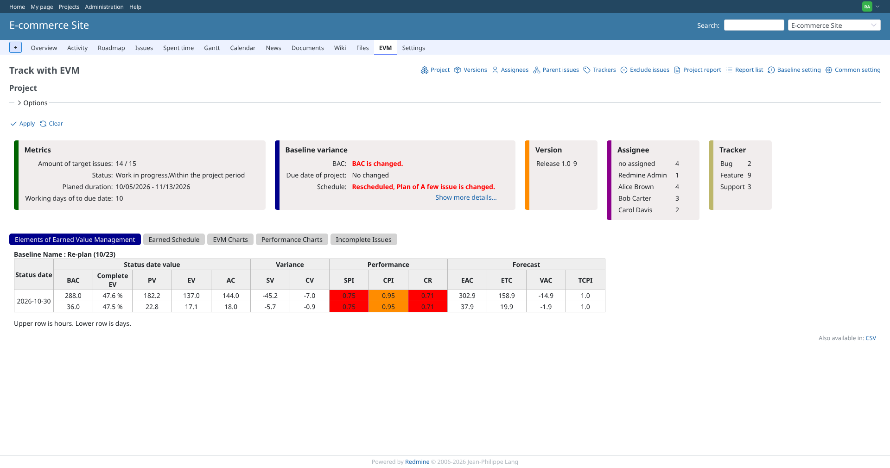
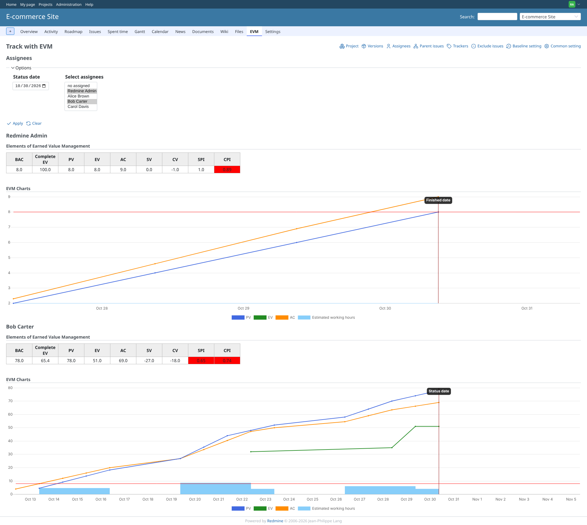
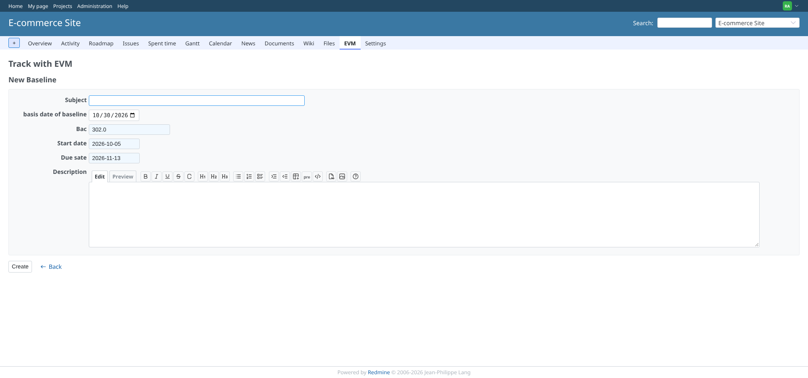
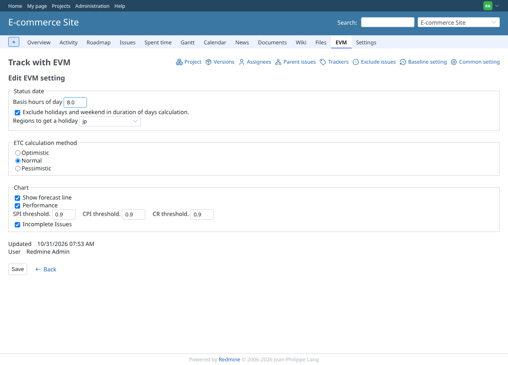

# Feature reference

What each page shows and which permission it needs. For the meaning of the values, see [Reading EVM](evm-basics.md).

[Back to contents](index.md)

## Permissions

Set them under "EVM" in **Administration > Roles and permissions**.

| Permission | Pages and actions |
| --- | --- |
| View EVM | The EVM tab and its pages (Project, Versions, Assignees, Parent issues, Trackers, Exclude issues, baseline variance details). Members of the project only |
| View Baseline | Baseline list (history) and details |
| Edit Baseline | Create, edit and delete baselines (viewing included) |
| Edit Common Setting | Create and edit the common setting |
| View Project report | List, view, create, edit and delete project reports |

## Moving between pages

At the top right of each EVM page there are these links:

**Project** / **Versions** / **Assignees** / **Parent issues** / **Trackers** / **Exclude issues** / **Project report** and **Report list** (on the Project page only) / **Baseline setting** / **Common setting**

"Baseline setting" and "Common setting" are shown only when you have the permission.

## Options (all pages)

Open **Options** at the top of the page to change what is shown, then click **Apply**. **Clear** returns to today's date.

| Option | Page | What it does |
| --- | --- | --- |
| Status date | all | The date the values are calculated for. When you first open the page, it is today's date on your browser (device) |
| Use baseline for EVM value | Project | Choose the baseline for the calculation. "Not use" calculates with the current plan |
| Explanation | Project | Shows what each value means in the sidebar |
| Selection | the four breakdown pages | Choose versions, assignees, parent issues or trackers (several can be chosen) |

## Project (main page)

EVM for the whole project, including subprojects.

**Metrics**

| Item | Content |
| --- | --- |
| Amount of target issues | Number of issues in the EVM calculation |
| Status | State of the project (Work in progress, Finished, Over due date, No finished issues, Before project start date, Within the project period) |
| Planed duration | Planned start date to due date |
| Working days of to due date | Days left to the planned due date |
| Baseline variance | Only when a baseline is used. Whether BAC, the due date of the project and the schedule have changed, with a **Show more details...** link |
| Version / Assignee / Tracker | Number of issues in the calculation for each |

**Tabs**

| Tab | Content |
| --- | --- |
| Elements of Earned Value Management | BAC, Complete EV, PV, EV, AC, SV, CV, SPI, CPI, CR, EAC, ETC, VAC, TCPI. Upper row in hours, lower row in days. A **CSV** export link below the table |
| Earned Schedule | SAC, ES, AT, TV, TPI, TEAC, TVAC (in days) |
| EVM Charts | Cumulative PV, EV and AC. The baseline's PV and forecast lines (when enabled) |
| Performance Charts | SPI, CPI and CR over time (when enabled in the common setting) |
| Incomplete Issues | Issues whose due date is on or before the status date but that are not closed (and not 100% done) (when enabled in the common setting) |

## Versions / Assignees / Parent issues / Trackers

For each chosen item, shows the EVM values (BAC, Complete EV, PV, EV, AC, SV, CV, SPI, CPI) and a chart. Baselines are not used; the values come from the current issues.

- **Versions**: calculated from the issues with that target version.
- **Assignees**: calculated for each assignee. Issues with no assignee are grouped as "no assigned". The chart shows the estimated working hours per day and a line for "Basis hours of day".
- **Parent issues**: calculated from the chosen parent issue and its descendants.
- **Trackers**: calculated for each tracker.

## Exclude issues

The issues of the project that are not in the calculation. An issue is listed when either is true:

- It has no start date
- It has no due date, and its target version has no date either

Issues with no estimated time are not listed here (they are in the calculation as 0 hours).

## Baseline variance details

Opened from "Show more details..." on the main page. Compares the baseline in use with the current issues and shows three lists:

| List | Content |
| --- | --- |
| Modify issues | Issues whose start date, due date or estimated time has changed |
| New issues | Issues that entered the calculation after the baseline |
| Remove issues | Issues in the baseline that are no longer in the calculation |

## Baseline setting

| Page | Content |
| --- | --- |
| Baseline History | List of baselines (name, description, basis date of baseline, BAC, start date, due date, status, author, created, updated). Status is "Latest" or "old" |
| New Baseline | Enter the subject, basis date of baseline and description. BAC, start date and due date are filled in from the current issues |
| Baseline detail / Edit Baseline | View or fix the subject, basis date and description (the recorded plan of the issues cannot be changed) |

## Project report / Report list

| Page | Content |
| --- | --- |
| New Report | Records the EVM values (in days) for the status date and baseline of the main page, with the report details. Shows the difference from the previous report |
| Report list | List of reports (newest status date first) |
| Show Report / Edit Report | View a report, fix its details, or delete it |

## Common setting

A setting for each project. The page to create it opens the first time you open the EVM tab.

| Field | Content | Allowed values |
| --- | --- | --- |
| Basis hours of day | Hours per day, used to convert hours into days | a number greater than 0 |
| Exclude holidays and weekend in duration of days calculation | Leaves weekends and public holidays out of the working days | checkbox |
| Regions to get a holiday | Region of the public holidays (holidays gem) | choose from the list |
| ETC calculation method | Optimistic / Normal / Pessimistic | one of them (required) |
| Show forecast line | Shows forecast lines in the EVM chart | checkbox |
| Performance | Shows the Performance Charts tab | checkbox |
| SPI / CPI / CR threshold | Values at or below this are shown in red | more than 0, up to 0.99 |
| Incomplete Issues | Shows the Incomplete Issues tab | checkbox |

## Project overview page

For projects with a common setting, the overview page shows an EVM summary as of today (status date, baseline name, BAC, PV, EV, AC, SV, CV, SPI and CPI). The upper row is in hours, the lower row in days. Without a common setting, it says "You need to do the initial setup of the EVM plugin".

## Activity and search

Creating and updating baselines and project reports appear in Redmine's **Activity**. **Search** finds baseline subjects and descriptions, and report details.
