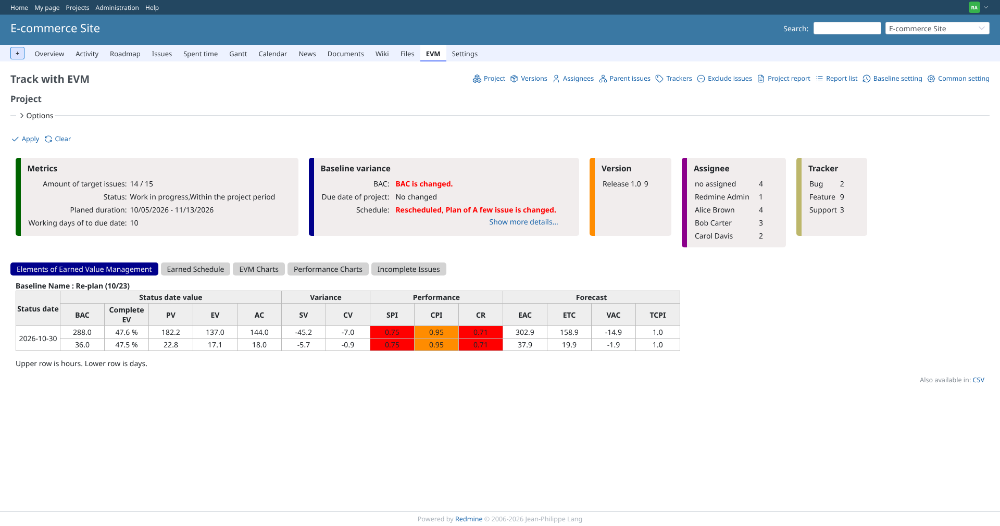
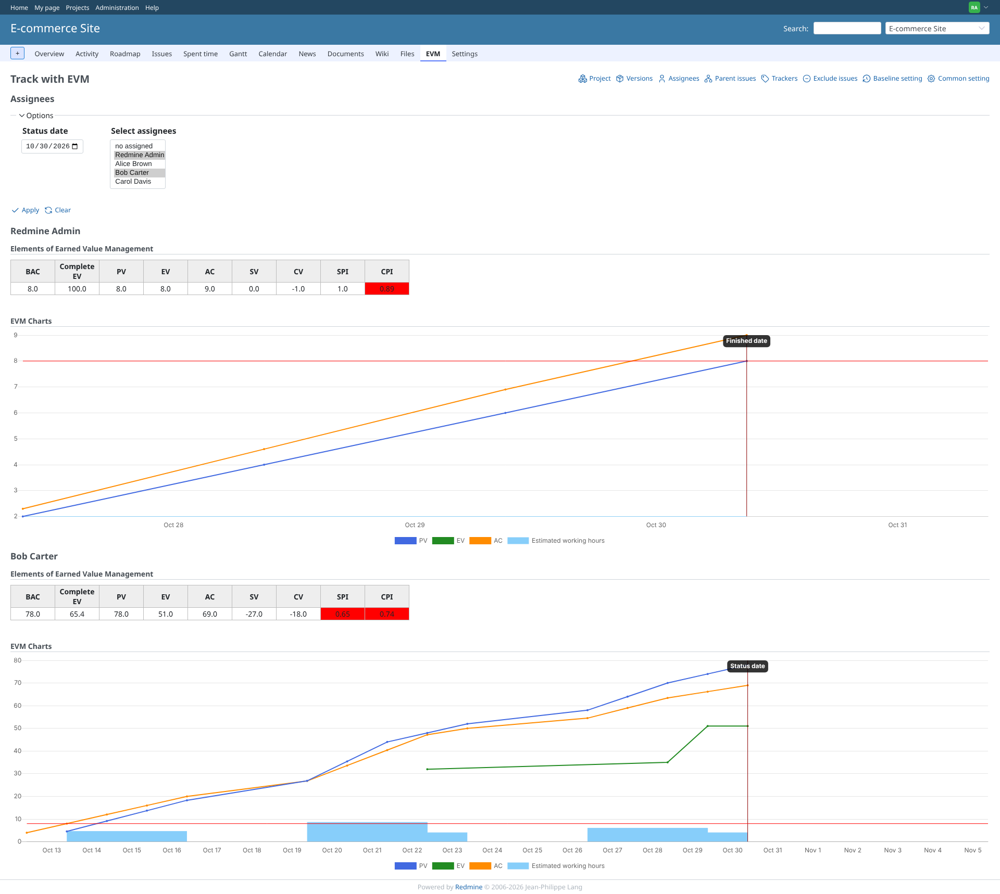
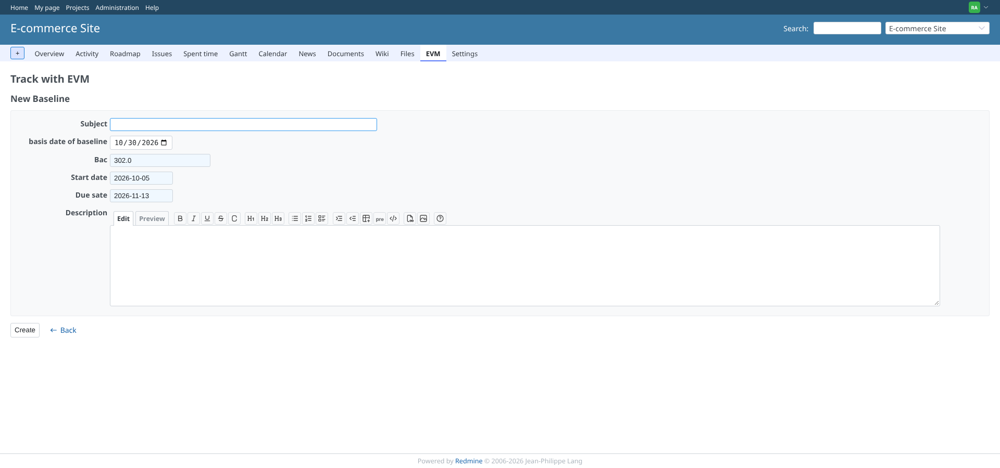
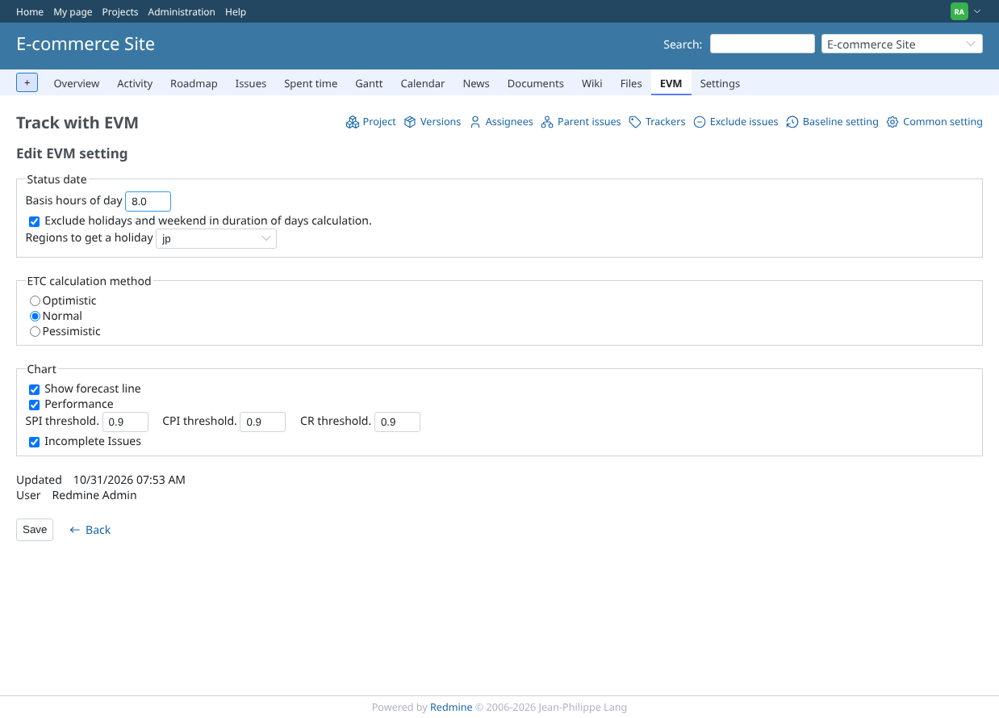

# 機能リファレンス

画面ごとに、表示される内容と必要な権限をまとめます。値の意味は [EVMの読み方](evm-basics.md) を参照してください。

[目次に戻る](index.md)

## 権限の一覧

権限は **管理 > ロールと権限** の「EVM」の欄で設定します。

| 権限 | 使える画面・操作 |
| --- | --- |
| EVMプラグインタブの表示 | EVMタブと各画面（プロジェクト、バージョン別、担当者別、親チケット別、トラッカー別、EVMの計算から除外されているチケット、ベースラインとの差異）。プロジェクトのメンバーのみ |
| ベースラインの一覧表示 | ベースラインの一覧（履歴）、詳細 |
| ベースラインの設定 | ベースラインの作成、編集、削除（表示を含む） |
| EVM設定の編集 | 共通設定の作成、編集 |
| プロジェクト報告 | プロジェクト報告の一覧、表示、作成、編集、削除 |

## 画面の移動

EVMの各画面の右上に、次のリンクが並びます。

**プロジェクト** / **バージョン別** / **担当者別** / **親チケット別** / **トラッカー別** / **EVMの計算から除外されているチケット** / **プロジェクト報告**・**報告一覧**（プロジェクトの画面のみ） / **ベースラインの設定** / **共通設定**

「ベースラインの設定」と「共通設定」は、権限があるときだけ表示されます。

## オプション（各画面共通）

画面上部の **オプション** を開くと、表示の条件を変えられます。変えたら **適用** をクリックします。**クリア** で今日の日付に戻ります。

| オプション | 画面 | 内容 |
| --- | --- | --- |
| 基準日 | すべて | どの日の時点で計算するか。初めて開いたときは、ブラウザ（端末）の今日の日付 |
| ベースラインの利用 | プロジェクト | 計算に使うベースラインの選択。「ベースラインを使用しない」で今の計画で計算 |
| EVM値の説明 | プロジェクト | 各値の説明をサイドバーに表示 |
| 対象の選択 | 内訳の4画面 | バージョン・担当者・親チケット・トラッカーを選ぶ（複数選択可） |

## プロジェクト（メイン画面）

プロジェクト全体（子孫プロジェクトを含む）のEVMです。

**基本情報**

| 項目 | 内容 |
| --- | --- |
| 対象となっているチケットの件数 | EVMの計算に入っているチケットの数 |
| ステータス | プロジェクトの状態（作業中です、プロジェクトは完了しています、期日を過ぎています、完了しているタスクがありません、プジェクト開始日前です、プロジェクト期間内です） |
| プロジェクトの期間 | 計画の開始日〜期日 |
| 期日までの日数 | 計画の期日までの残り日数 |
| ベースラインとの比較 | ベースラインを使っているときだけ。BAC・プロジェクトの期限・スケジュールの変更の有無と、**差異の詳細を見る** へのリンク |
| バージョン・担当者・トラッカー | それぞれの計算対象のチケットの件数 |

**タブ**

| タブ | 内容 |
| --- | --- |
| EVM | BAC、Complete EV、PV、EV、AC、SV、CV、SPI、CPI、CR、EAC、ETC、VAC、TCPI。上段が時間、下段が日数。表の下に **CSV** 出力のリンク |
| ES | SAC、ES、AT、TV、TPI、TEAC、TVAC（単位は日数） |
| EVMチャート | PV・EV・ACの累積のグラフ。ベースラインのPVと、予測の線（設定で有効な場合） |
| パフォーマンスチャート | SPI・CPI・CRの推移（共通設定で有効な場合） |
| 未完了チケット | 基準日までに期日が来ているのに、終了していない（かつ進捗率が100%でない）チケット（共通設定で有効な場合） |

## バージョン別 / 担当者別 / 親チケット別 / トラッカー別

選んだ対象ごとに、EVMの値（BAC、Complete EV、PV、EV、AC、SV、CV、SPI、CPI）とグラフを表示します。ベースラインは使わず、今のチケットで計算します。

- **バージョン別**: 対象バージョンが設定されたチケットで計算します。
- **担当者別**: 担当者ごとに計算します。担当者のいないチケットは「担当者なし」になります。グラフには日ごとの予定時間（日毎予定時間）と、「一日の基準時間」の線が表示されます。
- **親チケット別**: 選んだ親チケットとその子孫のチケットで計算します。
- **トラッカー別**: トラッカーごとに計算します。

## EVMの計算から除外されているチケット

プロジェクトのチケットのうち、計算に入っていないチケットの一覧です。次のどちらかに当てはまるチケットが表示されます。

- 開始日が入っていない
- 期日が入っておらず、対象バージョンにも期日がない

予定工数が空のチケットは、この一覧には出ません（計算には0時間として入っています）。

## ベースラインとの差異（差異の詳細）

メイン画面の「差異の詳細を見る」から開きます。使っているベースラインと今のチケットを比べて、次の3つの一覧を表示します。

| 一覧 | 内容 |
| --- | --- |
| 変更されたチケット | 開始日・期日・予定工数のどれかが変わったチケット |
| 追加されたチケット | ベースラインのあとに計算対象になったチケット |
| 除外になったチケット | ベースラインにはあるが、今は計算対象でないチケット |

## ベースラインの設定

| 画面 | 内容 |
| --- | --- |
| ベースラインの履歴 | 作ったベースラインの一覧（ベースライン名、説明、ベースラインの基準日、BAC、開始日、期限、ステータス、作成者、作成日時、更新日時）。ステータスは「最新」か「old」 |
| ベースラインの作成 | 題名・ベースラインの基準日・説明を入れて作成。BAC・開始日・期限は今のチケットから自動で入る |
| ベースラインの詳細・編集 | 題名・ベースラインの基準日・説明を見る・直す（記録したチケットの計画は変えられない） |

## プロジェクト報告 / 報告一覧

| 画面 | 内容 |
| --- | --- |
| レポートの作成 | メイン画面の基準日とベースラインで、EVMの値（日数）と報告内容を記録。前回の報告との差を表示 |
| レポート一覧 | 報告の一覧（基準日の新しい順） |
| レポートの照会・編集 | 報告の表示、報告内容の修正、削除 |

## 共通設定

プロジェクトごとの設定です。最初にEVMタブを開いたときに作成画面が表示されます。

| 項目 | 内容 | 入力できる値 |
| --- | --- | --- |
| 一日の基準時間 | 時間を日数に換算するときの1日の時間 | 0より大きい数 |
| 日数の計算は休日および祝日を除外する | 土日・祝日を作業日から除く | チェック |
| 休日の設定 | 祝日の地域（holidays gem） | 一覧から選ぶ |
| ETCの計算方法 | 楽観的 / 普通 / 悲観的 | どれか1つ（必須） |
| 予測値の表示 | EVMチャートに予測の線を表示 | チェック |
| パフォーマンスチャートの表示 | パフォーマンスチャートのタブを表示 | チェック |
| SPI・CPI・CRの閾値 | この値以下を赤で表示 | 0より大きく0.99以下 |
| 未完了チケットの表示 | 未完了チケットのタブを表示 | チェック |

## プロジェクトの概要ページ

共通設定があるプロジェクトでは、概要ページに今日の時点のEVMのサマリー（基準日、ベースライン名、BAC・PV・EV・AC・SV・CV・SPI・CPI）を表示します。上段が時間、下段が日数です。共通設定がないときは「EVM設定を行う必要があります」と表示されます。

## 活動と検索

ベースラインとプロジェクト報告の作成・更新は、Redmineの **活動** に表示されます。また、**検索** でベースラインの題名・説明と、報告内容を検索できます。
